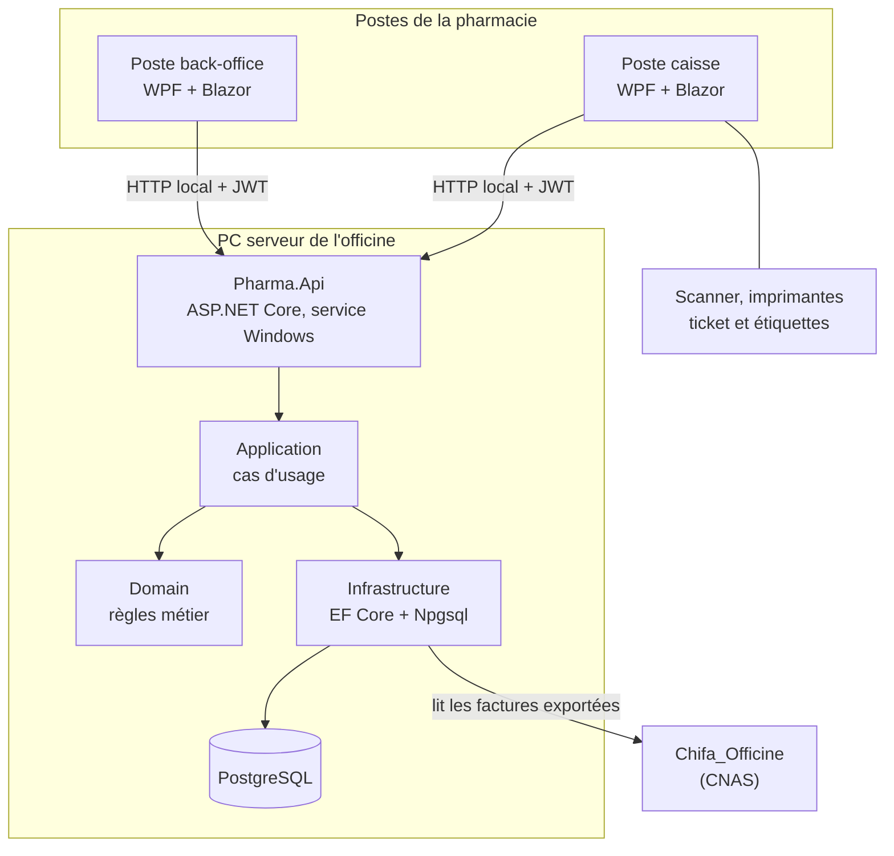

# Architecture

Tout tourne dans la pharmacie : un PC serveur héberge PostgreSQL et l’API ; les postes (caisse, back-office) passent toujours par l’API, jamais directement par la base.



## Couches

Clean Architecture : les dépendances pointent vers le domaine, jamais l’inverse (voir l’[ADR 0004](adr/0004-clean-architecture.md)).

| Projet | Rôle | Dépend de |
| --- | --- | --- |
| Pharma.Domain | Entités, statuts typés, règles métier pures (FEFO, péremption, crédit, EAN-13, Data Matrix) | — |
| Pharma.Application | Cas d’usage par fonctionnalité, ports (interfaces) qu’ils utilisent, modèles de résultat | Domain |
| Pharma.Infrastructure | Adaptateurs des ports : PostgreSQL (lecture Npgsql, écriture EF Core), sécurité, horloge, impression, Chifa | Application |
| Pharma.Api | Hôte : points d’accès HTTP, conversion vers les DTO, JWT, contrôle des droits, tâche des alertes | Application, Infrastructure, Shared |
| Pharma.Shared | Contrat HTTP (DTO) entre l’API et les postes | — |
| Pharma.Desktop | Interface des postes (Blazor dans une fenêtre WPF) | Shared |

### Organisation par fonctionnalité

```
Pharma.Application/
  Catalogue/     RechercherProduits, ObtenirLotFefo, ICatalogueLecture, ILotsLecture
  Alertes/       ListerAlertesOuvertes, GenererAlertes, IAlertesLecture, IMoteurAlertes
  Tracabilite/   ConsulterParcoursBoite, ITracabiliteLecture
  Securite/      SeConnecter, IPermissionService, IComptesLecture, IVerificateurMotDePasse, IGenerateurJeton
  Chifa/ Reprise/ Commun/   connecteurs et horloge
Pharma.Infrastructure/
  Lecture/       requêtes SQL qui alimentent les ports de lecture
  Persistence/   PharmaDbContext (écritures, sans migrations)
  Alertes/ Securite/ Systeme/ Impression/ Chifa/
Pharma.Api/
  Endpoints/     un fichier par fonctionnalité + ConversionsDto
  Securite/ Taches/
```

Un cas d’usage est une classe injectée avec une méthode `ExecuterAsync`, sans bibliothèque de médiation. Il travaille avec les entités du domaine et renvoie ses propres modèles ; l’API les convertit en DTO de `Pharma.Shared`.

### Tests

| Projet | Vérifie |
| --- | --- |
| `Pharma.Domain.Tests` | Règles métier du domaine |
| `Pharma.Application.Tests` | Cas d’usage, avec des doublures des ports |
| `Pharma.Architecture.Tests` | Sens des dépendances entre couches, mapping EF (sans base) |

## Principes

- **Hors ligne** : aucune dépendance au cloud. Internet n’est utile qu’à Chifa_Officine et à l’envoi des e-mails au titulaire par le serveur SMTP de la pharmacie ; les SMS passent par un modem GSM (voir [notifications.md](notifications.md)).
- **Règles dans le domaine, base en filet** : les règles métier sont écrites et testées dans `Pharma.Domain` et appliquées par les cas d’usage (ex. le lot FEFO est choisi par `Lot.Fefo`). Les règles critiques (lot périmé ou bloqué, registre des psychotropes, journal non modifiable) restent aussi garanties par la base (déclencheurs), en dernier recours.
- **Droits côté serveur** : chaque point d’accès vérifie la permission avec `a_permission()`. Masquer un bouton ne suffit pas.
- **Schéma piloté par SQL** : voir [base-de-donnees.md](base-de-donnees.md) et l’[ADR 0002](adr/0002-schema-pilote-par-sql.md).
- **Montants** : `decimal` en .NET, `numeric(12,2)` en base, en dinars. Dates d’horodatage en UTC (`timestamptz`), dates de péremption en `DateOnly`.

## Erreurs

Une règle métier violée (`RegleMetierException`) ou un refus de la base (`RAISE EXCEPTION`, code `P0001`) est renvoyé au poste en HTTP 422 avec le message lisible au comptoir.
