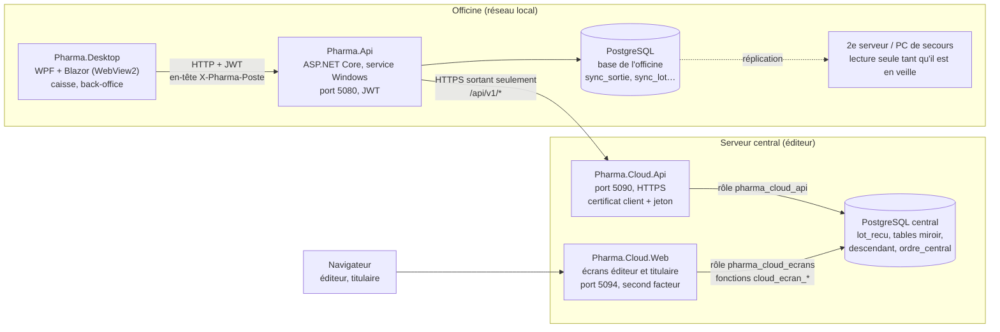
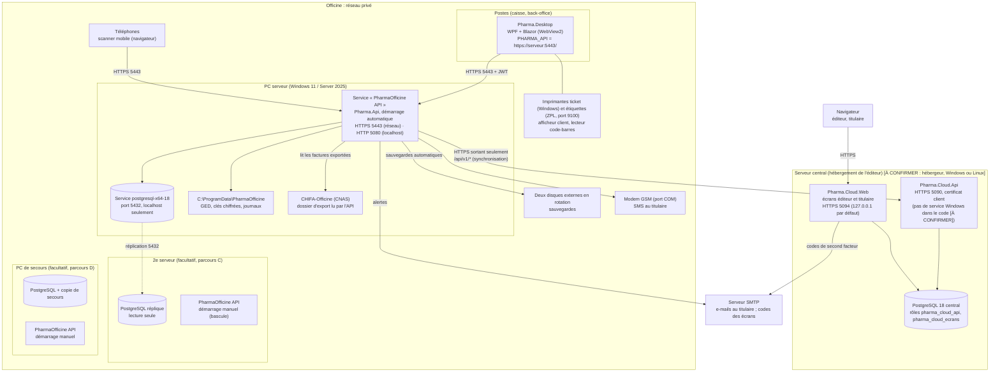
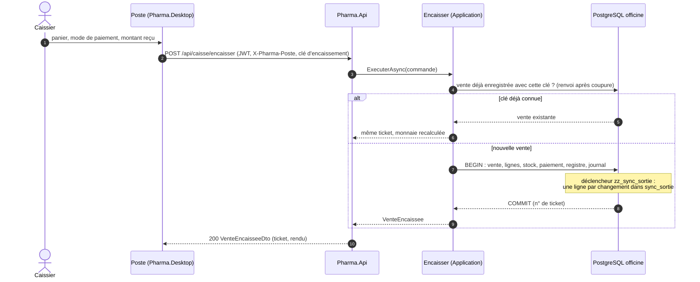
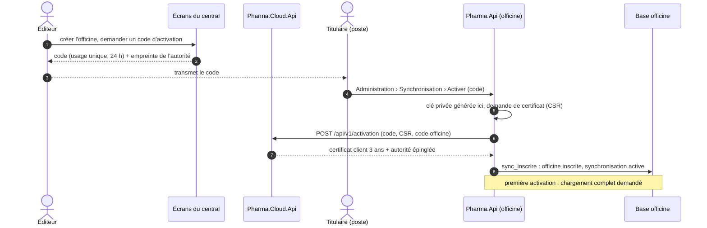
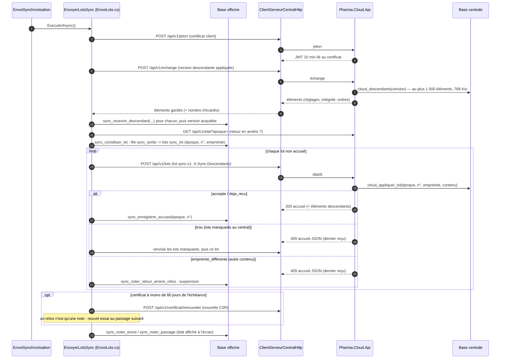
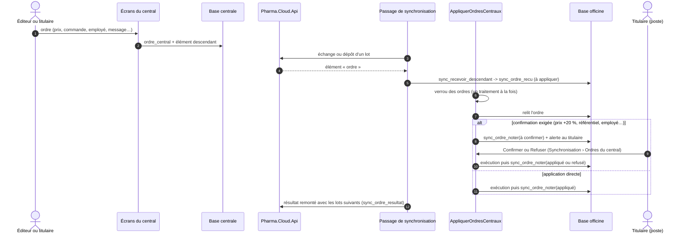
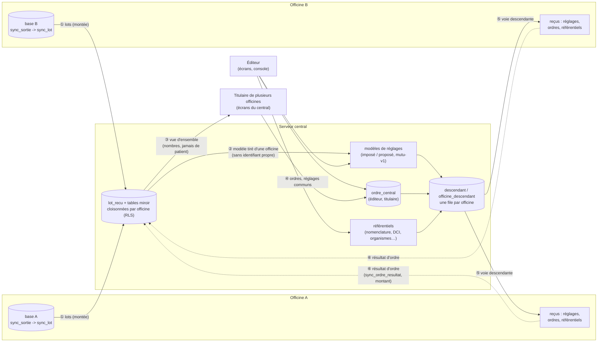
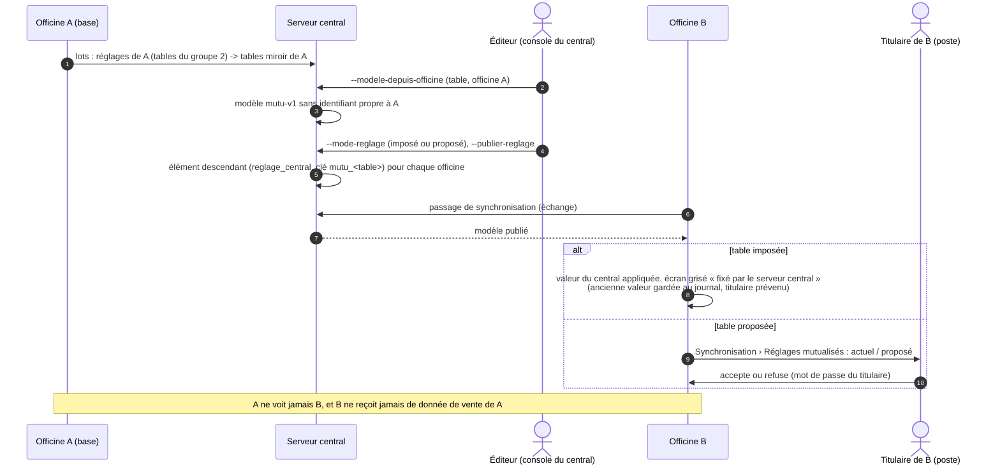
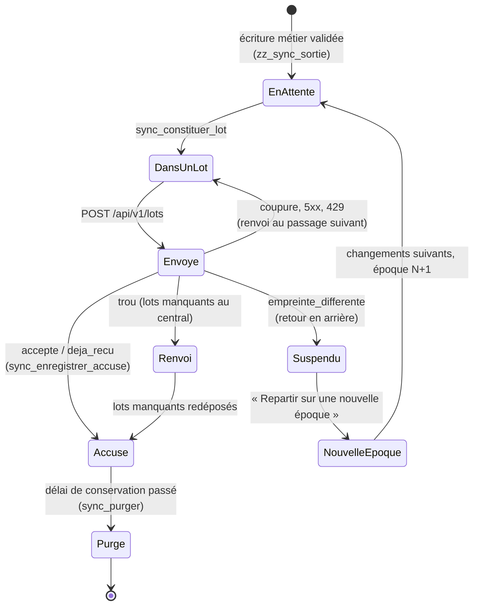

# Architecture et diagrammes de séquence

Vue technique de bout en bout : les composants, puis les échanges principaux sous forme de diagrammes de séquence (Mermaid).
Compléments : [architecture.md](architecture.md) (couches de l'officine), [conception-synchronisation.md](conception-synchronisation.md)
(détail de la synchronisation), [ecrans-central.md](ecrans-central.md) (écrans du serveur central), [base-de-donnees.md](base-de-donnees.md).

## 1. Composants



| Brique | Rôle | Où dans le code |
| --- | --- | --- |
| Poste | Écrans du comptoir et du back-office ; ne touche jamais la base | `src/Pharma.Desktop` |
| API de l'officine | Cas d'usage, droits, tâches de fond (dont la synchronisation) | `src/Pharma.Api`, `Pharma.Application`, `Pharma.Infrastructure` |
| Base de l'officine | Seule source de vérité de l'officine ; file de synchronisation | `database/migration`, `database/init` |
| API centrale | Reçoit les lots, renvoie les accusés et la voie descendante | `src/Pharma.Cloud.Api` (`PointsEntree.cs`) |
| Écrans du central | Éditeur : officines, comptes, envoi des codes ; titulaire : tableau de bord, ordres | `src/Pharma.Cloud.Web` |
| Base centrale | Lots bruts, tables miroir cloisonnées par officine (RLS), files descendantes | `database/cloud` |

**Tâches de fond de l'API de l'officine** liées à la synchronisation : `EnvoiSynchronisation` (passages), `SurveillanceSynchronisation`
(alertes : échéance du certificat, retard), `PurgeSynchronisation` (lots accusés au-delà du délai de conservation).

## 1 bis. Déploiement : où tourne chaque composant

Source : [mise-en-production.md](mise-en-production.md) (ports, services, dossiers). Les points encore ouverts y sont marqués
**[À CONFIRMER]** et le restent ici.



| Machine | Composants | Ports ouverts | Démarrage |
| --- | --- | --- | --- |
| **PC serveur** | `PharmaOfficine API` (Pharma.Api), PostgreSQL 18, GED et clés (`C:\ProgramData\PharmaOfficine`), CHIFA-Officine | 5443 (HTTPS, postes et téléphones) ; 5080 et 5432 en `localhost` seulement (5432 ouvert au seul 2e serveur) | Automatique |
| **Postes** | Pharma.Desktop (`PHARMA_API` vers le PC serveur), imprimantes, afficheur, lecteur | Aucun | À l'ouverture de session |
| **Téléphones** | Navigateur (scanner mobile) | Aucun | — |
| **2e serveur** (facultatif) | PostgreSQL en réplique (lecture seule), API arrêtée | — | API démarrée seulement à la bascule |
| **PC de secours** (facultatif) | PostgreSQL et API, copie de secours | — | API démarrée seulement à la bascule |
| **Serveur central** | Pharma.Cloud.Api, Pharma.Cloud.Web, PostgreSQL central | 5090 (API centrale) ; 5094 (écrans) **[À CONFIRMER : exposition à l'hébergement]** | **[À CONFIRMER]** |

L'officine n'ouvre **aucun port vers Internet** : la synchronisation est un appel sortant de l'API vers le central.

## 2. Vente au comptoir (chemin d'une écriture)

Toute écriture d'une table envoyée est notée dans la file `sync_sortie`, **dans la même transaction** : rien ne peut être
enregistré sans être noté, rien n'est noté sans être enregistré.



## 3. Activation de la synchronisation (une fois par serveur)



## 4. Un passage de synchronisation

Lancé par `EnvoiSynchronisation` (régulièrement, ou à la demande). Un seul passage à la fois (`VerrouSync`). Le serveur en lecture
seule (2e serveur en veille) ne passe jamais.



## 5. Retour en arrière de la base et nouvelle époque

Après une restauration ou une bascule sur le 2e serveur, la base peut ignorer des lots que le central a déjà reçus.

```mermaid
sequenceDiagram
    autonumber
    participant A as Pharma.Api (démarrage)
    participant DB as Base officine
    participant C as Pharma.Cloud.Api
    actor T as Titulaire
    A->>DB: encaissement suspendu (aucun n° de ticket) jusqu'au contrôle
    A->>C: GET /api/v1/etat?epoque=N
    C-->>A: dernier lot reçu = 120 (la base n'en a que 100)
    A->>DB: sync_noter_retour_arriere, sync_avancer_compteur_ticket, sync_avancer_sequences
    Note over DB: tickets et identifiants avancés au-delà<br/>de ce que le central connaît
    A->>DB: synchronisation suspendue, alerte au titulaire
    T->>A: « Repartir sur une nouvelle époque »
    A->>DB: sync_nouvelle_epoque (époque N+1)
    A->>C: POST /api/v1/epoque (déclaration, fins de chaîne)
    C-->>A: époque enregistrée
    Note over A,C: les lots repartent en époque N+1 ;<br/>les ventes perdues restent au central, signalées
```

## 6. Ordre envoyé par le central



## 7. Connexion aux écrans du central

```mermaid
sequenceDiagram
    autonumber
    actor U as Éditeur ou titulaire
    participant W as Pharma.Cloud.Web
    participant CDB as Base centrale (cloud_ecran_*)
    participant M as Envoi du code (e-mail ; fichier en développement)
    U->>W: identifiant + mot de passe
    W->>CDB: cloud_ecran_debut_connexion / fin_connexion (BCrypt vérifié dans l'appli)
    alt mot de passe provisoire non utilisé dans sa durée de vie
        CDB-->>W: provisoire_expire (refus)
    else accepté
        CDB-->>W: code attendu (session à l'étape « code »)
        W->>M: code à 6 chiffres (5 min, usage unique)
        U->>W: code
        W->>CDB: session ouverte (empreinte du jeton seulement)
        opt mot de passe provisoire
            W-->>U: choisir son mot de passe
        end
    end
    loop chaque requête
        W->>CDB: cloud_ecran_session_valable : échéance glissante
        Note over W,U: inactivité réglée par rôle (5 à 60 min) ;<br/>bandeau « Rester connecté » 60 s avant
    end
```

## 8. Workflow de synchronisation entre officines et avec le central

**Aucun lien direct entre officines** : chaque officine ne parle qu'au central, par appels sortants. Ce qui « passe » d'une officine
à une autre transite toujours par le central, sous l'une de ces formes : un **modèle de réglages** tiré d'une officine et publié aux
autres (mutualisation), un **réglage commun** ou un **ordre** du titulaire envoyé à plusieurs de ses officines, un **référentiel** de
l'éditeur envoyé à toutes. Les données de vente d'une officine ne descendent jamais dans une autre.

### 8.1 Vue d'ensemble des flux



| Étape | Ce qui circule | Sens | Mécanisme |
| --- | --- | --- | --- |
| ① | Changements de chaque officine (ventes, stock, caisse, réglages…) minimisés | officine -> central | file `sync_sortie`, lots `sync_lot`, `POST /api/v1/lots`, `cloud_appliquer_lot` |
| ② | Valeurs réelles des réglages d'une officine prise comme modèle | central -> central | console `--modele-depuis-officine` (`ModeleDepuisOfficine`) : lit la table miroir, retire tout identifiant propre à l'officine, ne publie rien |
| ③ | Synthèse des officines du titulaire (tableau de bord, vue d'ensemble) | central -> écrans | fonctions `cloud_ecran_titulaire_*` sur les tables miroir des seules officines rattachées |
| ④ | Ordres à distance, réglages communs proposés | écrans -> central | `ordre_central` : un ordre par officine cochée (droit `ordres` accordé depuis le poste de chaque officine) |
| ⑤ | Réglages mutualisés, ordres, référentiels, résumé d'intégrité | central -> chaque officine | file descendante par officine ; `POST /api/v1/echange` ou accusé d'un lot ; `sync_recevoir_descendant` |
| ⑥ | Résultat de chaque ordre (appliqué, refusé, expiré, motif) | officine -> central | table montante `sync_ordre_resultat`, avec les lots suivants |

### 8.2 Mutualisation : un réglage de l'officine A devient le modèle de l'officine B



### 8.3 Réglage commun proposé par un titulaire à plusieurs officines

```mermaid
sequenceDiagram
    autonumber
    actor T as Titulaire (écrans du central)
    participant W as Pharma.Cloud.Web
    participant C as Base centrale
    participant O1 as Officine 1
    participant O2 as Officine 2
    T->>W: Mes officines › Réglages communs : un réglage, sa valeur, officines cochées, code
    W->>C: cloud_ecran_titulaire_envoyer_reglages : tout ou rien<br/>(droit « ordres » sur chaque officine, 24 h, 5 envois / heure)
    C->>C: un ordre « reglages » par officine (même envoi)
    par chaque officine, à son propre passage
        O1->>C: échange
        C-->>O1: ordre « reglages »
        O1->>O1: revérifié (liste fermée, bornes) puis « à confirmer »
    and
        O2->>C: échange
        C-->>O2: ordre « reglages »
        O2->>O2: revérifié puis « à confirmer »
    end
    Note over O1,O2: sur chaque poste, le titulaire accepte ou refuse<br/>(mot de passe ressaisi) ; rien ne s'applique sans acceptation
    O1-->>C: résultat (sync_ordre_resultat) avec les lots suivants
    O2-->>C: résultat
    W-->>T: Propositions envoyées : Proposé / Accepté / Refusé / Expiré par officine
```

### 8.4 Référentiel publié par l'éditeur à toutes les officines (exemple : nomenclature)

```mermaid
sequenceDiagram
    autonumber
    actor Ed as Éditeur
    participant C as Serveur central
    participant O as Chaque officine
    actor T as Titulaire (poste)
    Ed->>C: dépose le fichier du référentiel, ordre « nomenclature » pour les officines
    O->>C: passage : échange
    C-->>O: ordre (n° du fichier, taille, empreinte)
    O->>O: à confirmer par le titulaire (taille du fichier affichée)
    T->>O: Confirmer
    O->>C: GET /api/v1/referentiels/{id} (certificat de l'officine), téléchargé à la confirmation
    C-->>O: fichier
    O->>O: taille et empreinte SHA-256 vérifiées, import (mêmes règles que l'import local), sync_ordre_noter(appliqué)
    Note over O,C: fichier inconnu (404) ou différent : refus définitif ;<br/>central injoignable : l'ordre reste « à confirmer », rien n'est perdu
    Note over O: autres référentiels (DCI, classes suivies, organismes, prestations) :<br/>aperçu des changements calculé avant la confirmation
```

### 8.5 Cycle de vie d'un changement, de l'officine au central



## 9. Garanties transversales

| Garantie | Comment |
| --- | --- |
| Aucune entrée réseau dans l'officine | Seule l'API de l'officine appelle le central (HTTPS sortant) |
| Identité de l'officine | Certificat client émis par l'autorité du central, vérifié à chaque appel (révocation, échéance, officine résiliée) ; jeton de 10 min lié au certificat |
| Pas de donnée nominative au central | Patients et porteurs sous code (`sync_code_patient`, `sync_code_porteur`) ; colonnes interdites retirées (`sync_colonnes_interdites`) |
| Cloisonnement au central | RLS forcée sur chaque table (`officine_id = cloud_officine_courante()`) |
| Rien de perdu, rien en double | File dans la transaction métier ; lots numérotés et empreintés ; accusé avant de marquer reçu ; époques après un retour en arrière |
| Droits côté serveur | Chaque route de l'API de l'officine porte un `Exiger*` (test `RoutesProtegeesTests`) |
